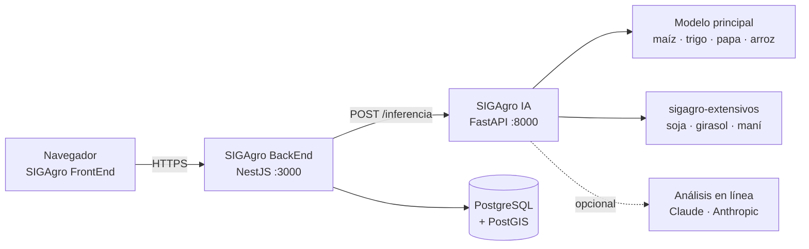
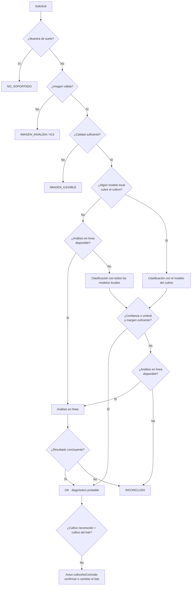

# SIGAgro IA

**Servicio de diagnóstico fitosanitario por imagen del Sistema Integral de Gestión Agronómica (SIGAgro).**


SIGAgro IA recibe la fotografía de una hoja o planta tomada en un lote y devuelve un **diagnóstico probable**
(enfermedad, plaga o deficiencia), su nivel de confianza e información técnica de referencia. El resultado se
registra en SIGAgro como *pendiente de validación* hasta que lo **revisa y valida un Ingeniero Agrónomo**.

> [!IMPORTANT]
> El servicio **asiste** al profesional; no lo reemplaza. Un resultado `OK` es un diagnóstico **probable**, nunca
> confirmado. El servicio **no estima la gravedad** y **no recomienda productos ni dosis**: los productos salen del
> catálogo fitosanitario oficial de SIGAgro y los indica el Ingeniero Agrónomo en la receta.

---

## Contenido

1. [Características](#características)
2. [Arquitectura](#arquitectura)
3. [Cultivos y afecciones cubiertos](#cultivos-y-afecciones-cubiertos)
4. [Requisitos](#requisitos)
5. [Instalación](#instalación)
6. [Ejecución](#ejecución)
7. [Configuración](#configuración)
8. [Integración con el backend de SIGAgro](#integración-con-el-backend-de-sigagro)
9. [Referencia de la API](#referencia-de-la-api)
10. [Lógica de decisión](#lógica-de-decisión)
11. [Principios de seguridad agronómica](#principios-de-seguridad-agronómica)
12. [Análisis en línea](#análisis-en-línea)
13. [Modelo `sigagro-extensivos`](#modelo-sigagro-extensivos)
14. [Limitaciones conocidas](#limitaciones-conocidas)
15. [Despliegue con Docker](#despliegue-con-docker)
16. [Pruebas](#pruebas)
17. [Estructura del proyecto](#estructura-del-proyecto)
18. [Solución de problemas](#solución-de-problemas)
19. [Créditos y licencias](#créditos-y-licencias)

---

## Características

- **Análisis en tres niveles**, del más económico al más amplio:

  | Nivel | Motor | Cultivos | Requiere |
  |---|---|---|---|
  | 1 | Modelo principal, local ([`wambugu71/crop_leaf_diseases_vit`](https://huggingface.co/wambugu71/crop_leaf_diseases_vit)) | Maíz, trigo, papa, arroz | — |
  | 2 | Modelo `sigagro-extensivos`, local, entrenado en este proyecto | Soja, girasol, maní | — |
  | 3 | Análisis en línea con un modelo multimodal (Claude, de Anthropic) | Cualquier cultivo de Argentina | Clave de API e internet (opcional) |

- **La foto se analiza siempre.** SIGAgro informa el cultivo sembrado en el lote (labor de siembra o ficha del lote) y
  el servicio usa el modelo que lo cubre; si ninguno lo cubre, usa el análisis en línea o, sin él, todos los modelos
  locales. Si en la foto se reconoce **otro cultivo**, el diagnóstico se informa igual con `cultivoNoCoincide: true` y
  un aviso para que el usuario confirme el lote o lo cambie (SIGAgro vuelve a analizar la foto con el lote correcto).
- **Control de calidad de la imagen** antes de analizar: resolución, iluminación y enfoque.
- **Prudencia ante la duda:** confianza baja o clases parejas producen `INCONCLUSO`, con el motivo y la indicación
  de tomar otra foto.
- **Trazabilidad:** cada respuesta identifica el modelo y la versión usados, el origen del análisis y el tipo de
  confianza.
- **Funcionamiento sin conexión** con los modelos locales; el análisis en línea es una mejora opcional.
- **Seguridad:** solo acepta imágenes embebidas (no descarga URLs), limita el tamaño y admite un token entre
  servicios.

## Arquitectura



- El **navegador nunca se comunica con este servicio**: lo consume únicamente el backend, a través de
  `ClienteInferenciaIA` (`SIGAgro-BackEnd/src/common/inferencia-ia/`). Por eso escucha en `127.0.0.1`.
- **Flujo en SIGAgro:** muestra (foto, campo, lote, tipo de muestra y cultivo) → inferencia → diagnóstico
  `PENDIENTE_VALIDACION` → revisión del Ingeniero Agrónomo (aceptar, rectificar o rechazar y definir la gravedad) →
  receta fitosanitaria con productos del catálogo oficial.
- **Tolerancia a fallos:** si el servicio no responde, SIGAgro registra la muestra como `ERROR_SERVICIO`
  ("IA no disponible") y permite reintentar el análisis más tarde. Ningún componente inventa un resultado.

## Cultivos y afecciones cubiertos

| Cultivo | Modelo | Clases |
|---|---|---|
| Maíz | Principal | Roya común · Mancha gris · Sano |
| Trigo | Principal | Roya anaranjada · Roya amarilla · Sano |
| Papa | Principal | Tizón temprano · Tizón tardío · Sano |
| Arroz | Principal | Mancha parda · Piricularia · Sano |
| Soja | `sigagro-extensivos` | Mancha ojo de rana · Roya · Mancha marrón (*Septoria*) · Mosaico (virosis) · Orugas defoliadoras · Vaquita de San Antonio (*Diabrotica speciosa*) · Sana |
| Girasol | `sigagro-extensivos` | Mildiu · Podredumbre gris · Sano |
| Maní | `sigagro-extensivos` | Viruela temprana · Viruela tardía · Roya · Deficiencia nutricional · Sano |
| Otros cultivos | En línea | Según lo que identifique el modelo, con las mismas reglas de prudencia |

La información de referencia de cada clase (agente causal, síntomas, condiciones predisponentes, consecuencias y
alternativas de manejo generales) está en [`app/conocimiento.py`](app/conocimiento.py).

## Requisitos

| Recurso | Mínimo |
|---|---|
| Sistema operativo | Windows 10/11 (scripts PowerShell incluidos) · Linux o macOS (manual o Docker) |
| Python | 3.13 |
| Memoria RAM | 2 GB libres |
| Disco | ~2,5 GB (PyTorch CPU, librerías y modelos) |
| Internet | Solo en la instalación (descarga del modelo principal, ~350 MB) y, si se habilita, para el análisis en línea |
| GPU | No necesaria |

## Instalación

Desde la carpeta `SIGAgro-IA`, en PowerShell:

```powershell
powershell -ExecutionPolicy Bypass -File .\instalar.ps1
```

El script es idempotente (se puede volver a ejecutar) y realiza:

1. Verificación de Python 3.13 (si falta, indica cómo instalarlo: `winget install Python.Python.3.13`).
2. Creación del entorno virtual `.venv`.
3. Instalación de dependencias (PyTorch para CPU, Transformers, FastAPI y el SDK de Anthropic).
4. Creación de `.env` a partir de `.env.example`.
5. Descarga anticipada del modelo principal.

Con `-Dev` instala además las herramientas de prueba y ejecuta la suite.

<details>
<summary><b>Instalación manual</b> (Linux, macOS o sin scripts)</summary>

```bash
python3.13 -m venv .venv
.venv/bin/pip install -r requirements-dev.txt --extra-index-url https://download.pytorch.org/whl/cpu
cp .env.example .env
```
</details>

## Ejecución

```powershell
powershell -ExecutionPolicy Bypass -File .\iniciar.ps1
```

`iniciar.ps1` carga las variables de `.env` y levanta el servicio en `http://127.0.0.1:8000`. Parámetros opcionales:
`-Puerto <n>` y `-Direccion 0.0.0.0` (solo si el backend se ejecuta en otra máquina).

Los scripts de la carpeta raíz del sistema (`start-dev.ps1`, `start-prod.ps1`) inician este servicio junto con el
backend y el frontend, y luego ejecutan `verificar-ia.ps1` para confirmar que quedó operativo.

**Verificación:**

| URL | Resultado esperado |
|---|---|
| <http://127.0.0.1:8000/salud> | `"estado": "OK"` |
| <http://127.0.0.1:8000/docs> | Documentación interactiva (Swagger UI) |

<details>
<summary><b>Ejecución manual</b></summary>

El servicio lee variables de entorno; no carga `.env` por sí mismo (eso lo hace `iniciar.ps1`).

```bash
export MODELO_REVISION=7d5b32bcd6f83a2f57e7e0346358fad276296877
.venv/bin/python -m uvicorn app.main:app --host 127.0.0.1 --port 8000
```
</details>

## Configuración

Todas las opciones se definen en `.env` (plantilla: [`.env.example`](.env.example)). El archivo `.env` está
excluido del control de versiones.

**Servicio y seguridad**

| Variable | Valor por defecto | Descripción |
|---|---|---|
| `TOKEN_SERVICIO` | *(vacío)* | Token compartido con el backend (`Authorization: Bearer`). Vacío: sin autenticación, solo para uso local |
| `MAX_BYTES` | `8388608` | Tamaño máximo de la imagen (8 MB). Si se supera: HTTP 413 |

**Modelos locales**

| Variable | Valor por defecto | Descripción |
|---|---|---|
| `MODELO_ID` | `wambugu71/crop_leaf_diseases_vit` | Modelo principal (Hugging Face `image-classification`) |
| `MODELO_REVISION` | revisión fijada en `.env.example` | Commit del modelo, para resultados reproducibles |
| `MODELOS_ADICIONALES` | `modelos/sigagro-extensivos` (si existe) | Modelos locales adicionales, separados por coma |
| `UMBRAL_CONFIANZA` | `0.60` | Probabilidad mínima para aceptar un resultado |
| `MARGEN_MINIMO` | `0.15` | Diferencia mínima entre la primera y la segunda clase |
| `ALTERNATIVAS` | `3` | Cantidad de diagnósticos alternativos informados |

**Control de calidad de la imagen**

| Variable | Valor por defecto | Descripción |
|---|---|---|
| `LADO_MINIMO_PX` | `160` | Resolución mínima del lado menor |
| `BRILLO_MINIMO` / `BRILLO_MAXIMO` | `35` / `235` | Brillo medio aceptado (escala 0–255) |
| `NITIDEZ_MINIMA` | `25` | Varianza mínima del laplaciano (detecta fotos movidas o desenfocadas) |

**Análisis en línea (opcional)**

| Variable | Valor por defecto | Descripción |
|---|---|---|
| `ANTHROPIC_API_KEY` | *(vacío)* | Clave de API de Anthropic. Vacía: solo modelos locales |
| `EN_LINEA` | `auto` | `auto` (se habilita si hay clave) · `si` · `no` |
| `MODELO_EN_LINEA` | `claude-opus-5-5` | Modelo multimodal utilizado |
| `ESFUERZO_EN_LINEA` | `medium` | Nivel de razonamiento: `low` · `medium` · `high` · `xhigh` · `max` |
| `TIMEOUT_EN_LINEA` | `45` | Tiempo máximo de espera, en segundos |
| `UMBRAL_EN_LINEA` | `0.60` | Confianza estimada mínima para aceptar el resultado |

> [!CAUTION]
> La clave `ANTHROPIC_API_KEY` es secreta: nunca debe incluirse en el repositorio ni compartirse.

## Integración con el backend de SIGAgro

En `SIGAgro-BackEnd/.env`:

```env
AI_SERVICE_URL=http://127.0.0.1:8000
AI_SERVICE_TOKEN=              # mismo valor que TOKEN_SERVICIO (vacío si no se usa)
AI_SERVICE_TIMEOUT_MS=60000    # el análisis en línea puede demorar más que el local
```

> [!NOTE]
> Se recomienda `127.0.0.1` en lugar de `localhost`: en Windows `localhost` puede resolverse a la dirección IPv6
> `::1`, en la que el servicio no escucha.

Con la integración activa, la pantalla **Diagnóstico IA** de SIGAgro muestra el estado del servicio y los cultivos
cubiertos (el backend consulta `/salud` y `/modelo` mediante `GET /api/diagnostico-ia/diagnosticos/servicio-ia`).

## Referencia de la API

| Método | Ruta | Autenticación | Descripción |
|---|---|---|---|
| `GET` | `/salud` | No | Estado del servicio, de los modelos y del análisis en línea |
| `GET` | `/modelo` | Token\* | Modelos cargados, versiones, etiquetas y cultivos cubiertos |
| `POST` | `/inferencia` | Token\* | Análisis de una fotografía |

\* Solo si `TOKEN_SERVICIO` está configurado: `Authorization: Bearer <TOKEN_SERVICIO>`.

### `POST /inferencia`

**Solicitud**

```json
{
  "imagen": "data:image/jpeg;base64,/9j/4AAQ...",
  "formato": "jpg",
  "cultivo": "Soja",
  "tipoMuestra": "PLANTA",
  "origen": "MUESTRA_MONITOREO",
  "observaciones": "Manchas en hojas del tercio medio"
}
```

| Campo | Requerido | Descripción |
|---|---|---|
| `imagen` | Sí | Imagen JPG, PNG o WEBP como data URL o base64. No se aceptan URLs remotas |
| `formato` | No | Formato informado por el cliente |
| `cultivo` | Recomendado | Cultivo sembrado en el lote. Determina el modelo y permite detectar incoherencias |
| `tipoMuestra` | No | `PLANTA` (por defecto) · `CULTIVO` · `SUELO` |
| `origen` | No | `MUESTRA_MONITOREO` (por defecto) · `EVIDENCIA_LABOR` |
| `observaciones` | No | Notas de campo; se usan como contexto en el análisis en línea |

**Respuesta `200`** (estructura constante; los campos de la afección quedan vacíos si no hay diagnóstico):

```json
{
  "versionContrato": 2,
  "estado": "OK",
  "mensaje": "",
  "afeccion": "Mancha ojo de rana de la soja",
  "agente": "Cercospora sojina (hongo)",
  "confianza": 0.874,
  "tipoConfianza": "PROBABILIDAD",
  "severidad": null,
  "tipoDeteccion": "ENFERMEDAD",
  "cultivo": "Soja",
  "estadoPlanta": "Con síntomas compatibles con mancha ojo de rana de la soja.",
  "descripcion": "...",
  "sintomas": ["..."],
  "condiciones": ["..."],
  "consecuencias": ["..."],
  "alternativasControl": ["..."],
  "recomendaciones": "...",
  "alternativas": [{ "etiqueta": "Soybean___Septoria_Brown_Spot", "afeccion": "Mancha marrón de la soja", "cultivo": "Soja", "confianza": 0.07 }],
  "observaciones": ["Resultado probable generado por un modelo de IA: no es un diagnóstico confirmado. ..."],
  "etiquetaModelo": "Soybean___Frog_Eye_Leaf_Spot",
  "origenAnalisis": "LOCAL",
  "modelo": { "id": "modelos/sigagro-extensivos", "version": "local-..." },
  "calidadImagen": { "ancho": 960, "alto": 720, "formato": "JPEG", "brillo": 128.4, "nitidez": 310.2, "legible": true, "problemas": [] },
  "fuenteInformacion": "...",
  "tiempoProcesamientoMs": 214
}
```

| Campo | Descripción |
|---|---|
| `estado` | Resultado del análisis (ver [Lógica de decisión](#lógica-de-decisión)) |
| `confianza` | Valor entre 0 y 1. **No indica gravedad** |
| `tipoConfianza` | `PROBABILIDAD` (salida softmax de un modelo local) o `ESTIMADA` (estimación del modelo en línea) |
| `origenAnalisis` | `LOCAL` o `EN_LINEA` |
| `severidad` | Siempre `null`: la gravedad la determina el Ingeniero Agrónomo |
| `alternativas` | Otras clases consideradas, con su confianza. En un resultado `INCONCLUSO` incluyen la clase más probable |
| `cultivoIndicado` | Cultivo informado en la solicitud (el sembrado en el lote) |
| `cultivoNoCoincide` | `true` si en la foto se reconoce otro cultivo: el resultado se informa igual, con un aviso para confirmar o cambiar el lote |
| `calidadImagen` | Medidas de calidad y problemas detectados en la foto |

**Códigos de error:** `401` token inválido · `413` imagen demasiado grande · `422` solicitud mal formada ·
`503` modelo no disponible o en carga.

<details>
<summary><b>Ejemplo de prueba desde PowerShell</b></summary>

```powershell
$b64  = [Convert]::ToBase64String([IO.File]::ReadAllBytes("C:\fotos\hoja-soja.jpg"))
$body = @{ imagen = "data:image/jpeg;base64,$b64"; cultivo = "Soja"; tipoMuestra = "PLANTA" } | ConvertTo-Json
Invoke-RestMethod http://127.0.0.1:8000/inferencia -Method Post `
  -ContentType "application/json; charset=utf-8" -Body ([Text.Encoding]::UTF8.GetBytes($body))
```
</details>

## Lógica de decisión



| Estado | Significado | Tratamiento en SIGAgro |
|---|---|---|
| `OK` | Diagnóstico probable | Queda `PENDIENTE_VALIDACION`, con gravedad `SIN_DETERMINAR` |
| `INCONCLUSO` | No se identificó con seguridad suficiente | Se solicita otra foto o la revisión del Ingeniero Agrónomo |
| `IMAGEN_INVALIDA` | El archivo no es una imagen válida o no muestra una hoja analizable | Se solicita otra foto |
| `IMAGEN_ILEGIBLE` | Resolución, iluminación o enfoque insuficientes | Se solicita otra foto, indicando el problema |
| `NO_SOPORTADO` | Muestra de suelo | Queda para evaluación profesional o de laboratorio |

Cuando el cultivo reconocido en la foto no es el sembrado en el lote, el estado sigue siendo el del análisis (por
ejemplo `OK`) y la respuesta lleva `cultivoNoCoincide: true`. SIGAgro muestra el aviso "¿Estás seguro de que es este
lote?" con las opciones de confirmarlo o cambiarlo (`PATCH /api/diagnostico-ia/diagnosticos/:id/lote`), y en ese caso
vuelve a analizar la foto con el cultivo del lote correcto.

## Principios de seguridad agronómica

1. **Diagnóstico probable, no confirmado.** Toda respuesta `OK` incluye la advertencia correspondiente y requiere la
   validación del Ingeniero Agrónomo.
2. **Sin estimación de gravedad.** `severidad` es siempre `null`.
3. **Sin productos ni dosis.** La información de referencia describe solo medidas de manejo generales. Las respuestas
   en línea se filtran para descartar cualquier frase con dosis. Hay pruebas automáticas que lo verifican.
4. **Confianza transparente.** Se informa sin ajustes y se distingue la probabilidad de un modelo local de la
   estimación de un modelo en línea.
5. **Ante la duda, `INCONCLUSO`.** En ese caso no se informan afección, síntomas ni recomendaciones.

## Análisis en línea

El análisis en línea amplía la cobertura a cualquier cultivo mediante un modelo multimodal de Anthropic (Claude).
Es **opcional**: sin clave o sin conexión, el servicio funciona solo con los modelos locales.

| Aspecto | Comportamiento |
|---|---|
| Cuándo se usa | Cultivo no cubierto por los modelos locales, o resultado local `INCONCLUSO` / imagen no reconocida como hoja |
| Cuándo no se usa | Muestras de suelo, fotos ilegibles y resultados locales concluyentes (sin costo adicional) |
| Formato | Salida estructurada con esquema JSON fijo, validada antes de usarse |
| Fallos | Sin conexión, clave inválida o límite de uso: se conserva el resultado local |
| Respaldo | Si el modelo declina un pedido, la API lo reintenta automáticamente en un modelo alternativo |
| Privacidad | Se envían la foto (recomprimida, máx. 1568 px), el cultivo, el tipo de muestra y las observaciones. No se envían datos personales |
| Costo | Variable según el uso; estimado en unos centavos de dólar por foto |

Para habilitarlo, crear una clave en <https://console.anthropic.com>, asignarla a `ANTHROPIC_API_KEY` en `.env` y
reiniciar el servicio. `GET /salud` informa `"enLinea": { "habilitado": true, ... }`.

## Modelo `sigagro-extensivos`

Modelo local para **soja, girasol y maní**, entrenado en este proyecto sobre un Vision Transformer liviano ya
especializado en hojas de cultivos. Se mantiene fijo su extractor de características y se entrena la capa de
clasificación con las clases nuevas (*linear probing*), técnica que permite entrenar en una computadora sin placa de
video. El proceso es reproducible y está documentado en [`entrenamiento/`](entrenamiento/).

| Aspecto | Detalle |
|---|---|
| Modelo base | `wambugu71/crop_leaf_diseases_vit` (ViT tiny, licencia MIT) |
| Datos | ~11.900 imágenes de cuatro conjuntos públicos CC BY 4.0 (ver [`entrenamiento/FUENTES.md`](entrenamiento/FUENTES.md)) |
| Técnica | Extractor fijo + capa de clasificación entrenada, con variantes de giro y recorte de cada foto |
| División | 80 % entrenamiento · 10 % validación · 10 % prueba (estratificada, semilla fija) |
| Resultado | **78,7 % de acierto** sobre 1.087 fotos de prueba nunca vistas (F1 macro 76,6 %) |
| Métricas | Precisión, sensibilidad y F1 por clase en [`modelos/sigagro-extensivos/METRICAS.md`](modelos/sigagro-extensivos/METRICAS.md) |

**Resultados por cultivo (conjunto de prueba):**

| Cultivo | Clases con mejor desempeño | Clases a mejorar |
|---|---|---|
| Girasol | Mildiu (F1 94 %), podredumbre gris (100 %), sano (95 %) | — |
| Maní | Viruela tardía (91 %), sano (83 %), roya (78 %) | Viruela temprana (74 %), deficiencia nutricional (74 %) |
| Soja | Vaquita (85 %), sana (80 %), mosaico (80 %), roya (71 %) | Mancha ojo de rana (35 %) y mancha marrón (43 %): pocas fotos de entrenamiento; orugas (66 %) |

Las clases con pocas fotos son las más débiles: el umbral de confianza y el margen mínimo evitan informar como
probable un resultado dudoso, y conviene sumar fotos propias de esas afecciones y reentrenar.

**Reproducir el entrenamiento:**

```powershell
.\.venv\Scripts\python.exe -m pip install -r requirements-entrenamiento.txt --extra-index-url https://download.pytorch.org/whl/cpu
.\.venv\Scripts\python.exe -m entrenamiento.preparar_datos    # descarga y prepara las imágenes (~9,6 GB de descarga)
.\.venv\Scripts\python.exe -m entrenamiento.entrenar          # entrena, evalúa y guarda en modelos/sigagro-extensivos (~1 h en CPU)
```

**Mejorarlo con fotos propias** (recomendado para uso productivo): agregar imágenes identificadas por un Ingeniero
Agrónomo en `entrenamiento/datos/<Etiqueta>/`, volver a entrenar y revisar las métricas. Para incorporar una clase
nueva, agregar además su ficha en `app/conocimiento.py`.

## Limitaciones conocidas

- **Origen de los datos.** Los modelos locales se entrenaron con imágenes de otros países (India, Brasil, Bangladesh)
  y, en el caso del modelo principal, con fotos de laboratorio. La precisión con fotos de lotes argentinos puede ser
  menor que la medida en pruebas.
- **Confusión entre cultivos.** En pruebas de campo, el modelo principal clasificó con alta confianza una hoja de maíz
  como trigo. Por eso el servicio compara lo reconocido con el cultivo del lote y avisa cuando no coinciden.
- **Cultivos no cubiertos sin análisis en línea.** Se analizan con todos los modelos locales y se informa el resultado
  más seguro, con el aviso de cultivo distinto: es una referencia que debe confirmar el Ingeniero Agrónomo.
- **Afecciones no incluidas.** Enfermedades relevantes en Argentina que no figuran en los datos (por ejemplo,
  *Verticillium* o *Sclerotinia* en girasol) no pueden ser reconocidas por los modelos locales.
- **Sin estimación de incidencia ni gravedad**, por diseño.

## Despliegue con Docker

La imagen incluye los modelos, por lo que en ejecución no requiere internet (salvo para el análisis en línea).

```bash
docker build -t sigagro-ia .
docker run -d --name sigagro-ia --restart unless-stopped \
  -p 127.0.0.1:8000:8000 \
  -e TOKEN_SERVICIO=<token-secreto> \
  -e ANTHROPIC_API_KEY=<clave-opcional> \
  sigagro-ia
curl http://127.0.0.1:8000/salud
```

- Publicar el puerto solo en `127.0.0.1` o en una red interna: el servicio no debe exponerse a internet.
- Reservar al menos 2 GB de RAM.
- La guía de despliegue del sistema completo (base de datos, backend, frontend, proxy y HTTPS) está en
  `DESPLIEGUE.md`, en la carpeta raíz de SIGAgro.

## Pruebas

```powershell
.\.venv\Scripts\python.exe -m pytest
```

La suite (37 pruebas) usa clasificadores y analizadores simulados: no descarga modelos, no requiere conexión y no
genera costos.

| Archivo | Cobertura |
|---|---|
| `tests/test_api.py` | Estados del análisis, umbral y margen, coherencia de cultivo, calidad de imagen, rechazo de URLs remotas, límite de tamaño, token y modelo no disponible |
| `tests/test_modelos_adicionales.py` | Selección del modelo según el cultivo y cultivos cubiertos |
| `tests/test_en_linea.py` | Análisis en línea: uso solo cuando corresponde, filtrado de dosis, baja confianza, cultivo distinto, fallos de conexión |

## Estructura del proyecto

```
SIGAgro-IA/
├── app/
│   ├── main.py              API (FastAPI): endpoints, autenticación y carga de modelos
│   ├── analisis.py          Lógica de decisión y armado de la respuesta
│   ├── en_linea.py          Análisis en línea (Claude): esquema, consulta y filtrado
│   ├── modelo.py            Carga de modelos locales (principal y adicionales)
│   ├── imagenes.py          Decodificación segura y control de calidad de la imagen
│   ├── conocimiento.py      Fichas de referencia por clase y normalización de cultivos
│   └── config.py            Configuración por variables de entorno
├── entrenamiento/
│   ├── preparar_datos.py    Descarga y preparación de imágenes
│   ├── entrenar.py          Entrenamiento, evaluación y exportación del modelo
│   └── FUENTES.md           Fuentes de datos, licencias y limitaciones
├── modelos/
│   └── sigagro-extensivos/  Modelo entrenado y sus métricas
├── tests/                   Pruebas automatizadas
├── instalar.ps1             Instalación en Windows
├── iniciar.ps1              Inicio en Windows (carga .env)
├── Dockerfile               Imagen de despliegue
├── .env.example             Plantilla de configuración
├── requirements.txt         Dependencias de ejecución
├── requirements-dev.txt     + dependencias de prueba
└── requirements-entrenamiento.txt  + dependencias de entrenamiento
```

## Solución de problemas

| Síntoma | Causa probable | Solución |
|---|---|---|
| SIGAgro muestra "IA no disponible" (`SIN_CONEXION`) | El servicio no está en ejecución o `AI_SERVICE_URL` es incorrecta | Iniciar el servicio; verificar `AI_SERVICE_URL=http://127.0.0.1:8000` y reiniciar el backend |
| `AUTENTICACION` o HTTP 401 | El token del backend no coincide con `TOKEN_SERVICIO` | Usar el mismo valor en ambos `.env` y reiniciar ambos servicios |
| `TIEMPO_AGOTADO` | Equipo lento o análisis en línea demorado | Aumentar `AI_SERVICE_TIMEOUT_MS` en el backend |
| `/salud` informa `MODELO_NO_DISPONIBLE` | Primera ejecución sin internet, memoria insuficiente o carga en curso | Esperar unos segundos; revisar el campo `error`; asegurar conexión en la instalación |
| Aviso "la foto no parece ser del cultivo del lote" | El lote elegido no es el de la foto, o el modelo confundió el cultivo | Cambiar el lote desde el aviso; si el lote es correcto, confirmarlo (el Ingeniero lo verá al validar) |
| `INCONCLUSO` frecuente | Fotos lejanas, varias hojas o fondo predominante | Fotografiar una sola hoja con síntomas, de cerca, con luz natural |
| El análisis en línea no se activa | Falta `ANTHROPIC_API_KEY` o `EN_LINEA=no` | Revisar `.env`, reiniciar el servicio y consultar `GET /salud` |
| `No existe el entorno virtual` | Instalación incompleta | Ejecutar `instalar.ps1` |

Desde la carpeta raíz de SIGAgro, `verificar-ia.ps1` diagnostica la instalación, la configuración y el estado del
servicio.

## Créditos y licencias

- **Modelo principal:** [`wambugu71/crop_leaf_diseases_vit`](https://huggingface.co/wambugu71/crop_leaf_diseases_vit), licencia MIT.
- **Datos de entrenamiento de `sigagro-extensivos`:** conjuntos publicados por Project-AgML bajo licencia
  CC BY 4.0; atribución completa en [`entrenamiento/FUENTES.md`](entrenamiento/FUENTES.md).
- **Análisis en línea:** API de Anthropic (Claude), sujeta a sus condiciones de uso.

Proyecto académico desarrollado en el marco del Seminario Integrador. La información agronómica es de referencia
general y no reemplaza el criterio profesional.
